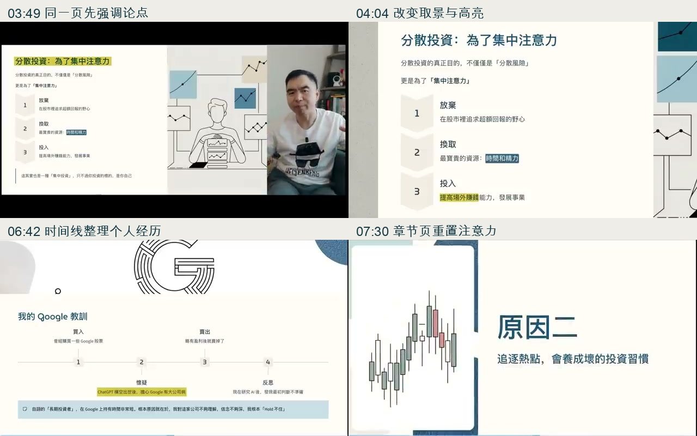
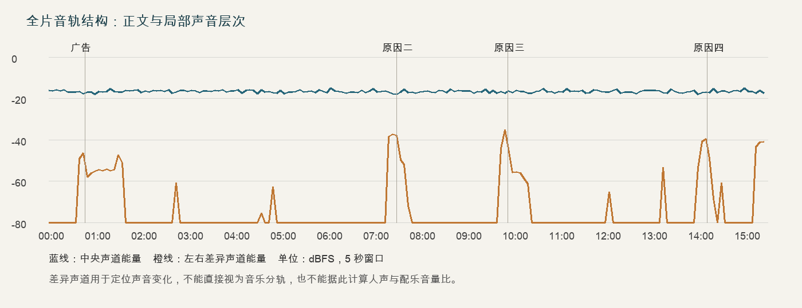

# 一口新饭为什么我不寻找下一个特斯拉制作风格分析

分析对象：用户提供的《一口新飯_為什麼我不尋找下一個特斯拉_20251011.mp4》。分析日期：2026-10-27。文件长 15:30.911，640×360，30 fps。文件名中的日期未另行核验。

这期的核心风格是**以个人选择为主线的观点讲述，配合讲义式视觉和局部声音变化组织长篇论证**。真人提供关系与态度，脚本推动理解，图文页面整理概念，声音变化标记部分转折。它最值得学习的是这些元素的分工，以及个人经历如何把抽象判断连接起来。

本期与此前分析的“囤现金”样本在视觉上有明显差别：本期更像真人讲解经过设计的讲义；“囤现金”样本更依赖反复变形的杠铃模型。不能把其中一期的画面形式概括为频道的唯一风格。

## 脚本如何建立观看理由

开头约 15 秒完成了三个动作：作者称自己长期持有特斯拉，说明这是个人成功经历，然后提出老观众的问题——既然成功过，为什么不寻找下一次类似机会。冲突来自“成功经验为什么不继续复制”，与标题直接对应。

随后出现 Nvidia、AMD、Oracle、Lemonade 等例子，把抽象问题转成观众熟悉的“错过上涨”。这些名称依据画面辨认，自动转写存在错词。约 00:41，作者承诺解释四个原因并推荐一本书，给观众明确的内容预期。

这里的吸引力有两个来源。第一，作者在解释一个由自己承担后果的选择，个人经验让话题有具体对象。第二，他回应的是观众已经可能产生的疑问，观看过程像在继续一场已有的对话。开头“好久没有聊投资”“今天聊聊天”的语气，也在维持这种熟人关系。

第一人称很重要。标题限定了“为什么我这样做”，为后文讨论精力、资产阶段、创业与信念留出空间。若将这个标题直接改写成普遍适用的投资结论，论据的支持范围就会发生变化。

## 四个理由如何逐层推进

下表按转写与章节画面定位，边界取约数，非官方章节。

| 约时间 | 内容动作 | 对论证的作用 |
|---|---|---|
| 00:00–00:47 | 个人持仓背景、观众疑问、热门股例子、四个理由的承诺 | 建立反差与观看预期 |
| 00:47–01:34 | Interactive Brokers 合作介绍，画面标注 AD | 在正文前完成商业插入 |
| 01:35–07:30 | 用“做事不要做一半”引出集中与分散，进而讨论资金、精力和 Google 经历 | 解释寻找更多股票的资源成本 |
| 07:31–09:52 | 从追涨动机推导短期交易、后悔下注不足与加杠杆 | 解释行为可能怎样偏离初衷 |
| 09:53–14:11 | 引入 The Wealth Ladder，将问题转向财富阶段与自己的事业 | 重新定义下一阶段值得投入的对象 |
| 14:12–15:22 | 表达对特斯拉未来的个人判断，并回到守好现有篮子与做好人生下一阶段 | 回答标题，完成首尾呼应 |
| 15:23–15:31 | 告别与结束画面 | 收束 |

这四个理由有清楚的递进：**资源是否足够 → 行为会怎样改变 → 当前阶段需要什么 → 为什么仍选择现有对象**。第三个理由把股票问题扩展成人生资源配置，是整篇观点的提升；第四个理由再回到特斯拉，避免标题被完全抛在身后。

第一部分约六分钟，明显长于另外几个理由。它要建立全片共用的前提：分散金融资产可以换取注意力，注意力可以集中到自身发展。这也提前铺垫了约 14:00 的回收——作者所说的下一个十倍机会，可能是自己的事业。

同时，脚本保留了多条稍后回收的线索。约 05:31 提到事业后说后面再讲；约 09:50 提到对特斯拉未来的信心，又留到最后解释。观众因此持续知道还有问题没有答完。

## 口语感来自具体的推理动作

“你比如”“所以你看”“那这跟我不找下一个特斯拉有什么关系”“当然这不代表”等连接词频繁出现。它们分别负责举例、归纳、拉回主线、补充边界。口语感来自这些动作，也来自句子短、经常自问自答、交替使用“我”和“你”。

他反复把抽象判断放进个人事件。约 06:33–07:02，Google 经历形成了买入、担忧、卖出、重新理解、反省信念的链条。约 12:28–13:05，与企业家的对话又包含事后的自我修正：曾以为投入更多资金就能扩张，后来发现自己的生意并不那么容易规模化。这些失败或修正使讲述者不只展示成功结果，也展示判断过程。

另一个有效动作是主动限制例子的适用范围。约 08:42–08:55 用 12 美元与 28 美元比较交易和持有，随后马上说明这只是简化例子，忽略下跌等复杂波动，并承认短期交易有其价值。这种安排既保持例子易懂，也避免把示意模型直接当作完整证明。

但自述、书籍引用和类比各有证据边界。视频中的投资收益、市场判断与人物转述在本报告中仅作为表达材料；页面上的插画和时间线不能替代原始记录。

## 真人画面如何承接脚本

作者坐在沙发前，书架、抱枕、窗户和生活物品可见。场景固定，服装随意，领口可见小型麦克风，整体建立的是在家交流的关系。成片有较宽和较近的取景，但不能据此确认机位数量或拍摄设备。

这期的人物运动很活跃：身体前倾，抬手列举，双手比较，指向自己，低头拿书。即使背景不变，人物本身仍持续提供视觉变化。脚本里涉及个人态度和经历的段落，经常回到全屏真人，使观众把判断与讲述者联系起来。

有两处实体元素直接参与表达。约 01:44–02:01，作者提到《绝命毒师》及“做事不要做一半”，身上的人物 T 恤呼应这个兴趣。约 10:13 起，作者拿起 The Wealth Ladder，书从口头引用变成现场可见的物件，此后仍多次拿在手中。相比单独插入一张书封面，拿书的动作把阅读经验连接到讲述者本人。

真人与页面也经常同时出现：讲义居左，真人占右侧窄栏，或以较小窗口叠在页面上。这让解释结构和人的表情同时存在，但也压缩了文本显示面积。

## 视觉系统如何降低理解负担

视觉底板主要为暖白、米灰和浅纹理背景，配深蓝绿色标题、浅蓝提示条、灰色分组块、黄色荧光笔式强调。插画以线描和低饱和色块为主，常见鸡蛋篮、人物、道路、阶梯、指南针、股票图与汽车等。

这些图形承担的任务不同：鸡蛋篮把集中与分散变成空间关系；道路与指南针为换方法提供隐喻；阶梯表达不同阶段；时间线整理事件顺序。另一些图主要提供主题提示，例如章节页上的股票图和汽车，并没有独立证明论点。

本期的图文页面有明显讲义特征：标题、两栏比较、编号、短段文字、总结条同时出现。已检查画面中未见贯穿的逐句底部字幕，屏幕文字主要保留结构与结论。它允许口播讲得比画面多，观众依赖声音获得完整推理。

### 高亮承担视觉重音

03:40–04:22 的连续抽样最能说明其机制。同一张“分散投资：为了集中注意力”页面先以图文加真人的形式出现；约 03:49 高亮标题；约 03:55–03:58 强调放弃追求超额回报；约 04:01–04:07 放大页面，强调提高场外赚钱能力；约 04:10 切回真人；随后返回页面并强调“投资的标的是自己”，再换到集中与分散的比较页。

这段通过**维持页面结构、移动强调位置、改变画面面积、返回人物**来组织注意力。观众不用每几秒重新认识一个场景，却能知道当前解释推进到了哪一步。

06:38–07:02 的 Google 页面也采用相同思路：先呈现四步时间线，依次突出担忧、卖出和反省；中间切回真人讲述，最后再回到总结条。画面负责让事件顺序不丢失，真人负责承接自我反省。

### 页面与动效的限制

在这份 360p 文件中，分屏、宽留白与局部黑边会进一步缩小正文，部分辅助文字难以快速读清。不能据此判断原始高分辨率版本的表现，但学习其形式时应避免把完整讲义缩进狭小区域。它更依赖主标题、高亮与口播，辅助文字不适合承担关键新信息。

局部序列可见页面淡入、构图移动、放大和高亮变化。现有抽样足以分析这些功能，不能据此还原制作软件、所有动效曲线或精确转场时长。

## 节奏由三个层次共同组成

宏观节奏来自章节和问题的升级。四个理由之间有明确的“原因二、三、四”页面，给连续讲述提供重新定位的机会。第一理由很长，之后进入行为与人生阶段，内容层级改变本身也构成节奏变化。

段落节奏来自概念、例子、反问和自我经历的交替。例如先讲理解公司的成本，再讲 Google 的个人教训；先讲财富阶段，再引入企业家对话。这些转换使同一个主张通过不同材料再次被理解。

局部节奏来自句子、手势、取景和高亮。脚本中的问句提出新的注意目标，画面突出相应词句或切回人物。07:30–07:33 的章节页在连续抽样中保持同一主构图，说明它允许观众停留在同一个视觉对象上。

全片自动转写约 4,883 个汉字，按总时长计算约 315 字／分钟。这是字符密度，包含广告和告别，并受英文、漏字和错词影响，不能当作精确发音速度。它至少说明内容密度不低：画面可以相对稳定，语言仍在持续推进。

开头约 47 秒插入合作介绍，约 01:34 才回到正文。作者口头说花“30 秒”，实际相关段落约 47 秒。广告与话题关联明确、画面有 AD 标识，但它仍延后了第一个理由的展开；对新观众而言，这可能提高继续等待的门槛。没有留存数据，不能推断实际流失。

## 音乐与声音如何参与结构

本项完成了全片混音响度、左右声道差异和短时低能量测量，没有完成完整主观听审。因此可以分析声音变化与内容节点的关系，不能确认曲名、乐器、曲风、BPM，或将每一处变化确定为音乐而非音效。

测量显示，正文大段音轨接近左右一致的中央声像，多个 15 秒区间内，较低的短时电平能降至约 −55 至 −68 dBFS。这与以讲话为中心、停顿较干净的声音组织相容，不支持直接把本片概括成全程由明显配乐推动。

较持续的左右差异声道能量集中在下列区间，时间来自 5 秒窗口，属于定位范围：

| 约时间 | 对应内容 | 可以支持的判断 |
|---|---|---|
| 00:40–01:40 | 内容预告、广告、回到正文 | 商业段及其前后存在不同的声音层次 |
| 07:20–07:50 | 第一理由收尾与“原因二”进入 | 声音变化提前于约 07:30 的章节页 |
| 09:45–10:25 | 第二理由收尾、原因三、书籍和读书会介绍 | 声音变化跨越了章节切换与关联内容展示 |
| 14:00–14:25 | 投资自己这一结论与“原因四”进入 | 又一次在章节页之前发生声音变化 |
| 15:15–结尾 | 标题答案回收、告别 | 收束段有额外声音层次，末尾音轨淡出 |

其中有价值的联系是**声音变化多次先于章节视觉变化发生**。例如约 07:20 已发生变化，07:30 才显示“原因二”；约 09:45 开始变化，09:54 抽样才见“原因三”；约 14:00 开始变化，14:12 抽样显示“原因四”。这可理解为声音在为转段做准备，让边界成为一段过程。

这不等于已证明音乐逐帧卡点，也不等于精确测出了配乐音量。左右差异声道含有音乐、音效或其他非同相成分，中央声道也可能包含音乐，不能将两者分别视作音乐和人声分轨。

全片综合响度约 −13.8 LUFS，响度范围 2.5 LU，真峰值约 +0.1 dBFS。它说明当前文件整体电平较稳定，不能反推出具体压缩器、录音设备或配乐配比；这些测值也不是建议照搬的制作目标。

图中低于 −80 dBFS 的值截断显示。对创作有用的启发是按段落功能配置声音：正文保证复杂论证可听懂，段落切换与收尾再增加声音层次。具体选曲的情绪和音色仍需结合实际听审决定。

## 各元素之间的具体联系

| 表达任务 | 脚本 | 人物与画面 | 声音关系 |
|---|---|---|---|
| 建立问题 | 成功过，却不继续寻找类似机会 | 真人直接开场，随后展示持仓背景与错过的公司 | 开头主体声像集中，解释承担主要信息 |
| 解释抽象关系 | 将分散资产与集中注意力联系起来 | 比较页、编号、高亮，按讲述重点改变构图 | 正文不需要靠持续明显的声音变化推动 |
| 展示反思 | 叙述 Google 买入、卖出与认识变化 | 时间线保存顺序，真人承接反省 | 保持叙述连续性更重要 |
| 开启新理由 | 用过渡句提出新的问题 | 简短章节页重置位置 | 多处声音变化提前于章节页，构成过渡 |
| 将观点扩展到人生 | 财富阶梯、自己做生意的经历 | 实体书、阶梯隐喻、对话页、真人 | 第三理由开头存在局部声音层次变化 |
| 回答标题 | 守好现有篮子，做好人生下一阶段 | 返回真人，结束前再改变取景 | 结尾增加声音层次并淡出 |

这套配合依赖先确定“此刻观众需要理解什么”。需要记住关系时使用图；需要感受个人立场时回到人；需要重新定位时使用章节；声音变化协助跨越部分边界。画面、声音和脚本不必在每个时刻同时做强烈变化。

## 与囤现金样本的共同点和差别

此前的[囤现金样本分析](yikouxinfan-cash-video-style-analysis.md)与本期可以支持几个有限的共同观察：两期都从作者自己的问题出发，都通过反问与补充条件推进，都把金融选择连接到人生资源，也都使用真人建立作者在场感。

区别在于，本期以四个理由分章，图文较接近讲义，视觉强调靠高亮和取景完成；此前样本以杠铃概念不断修正、扩展，模型自身承担更多推理。两期都使用浅色视觉，但不能仅以这个表面相似来定义风格。

## 对本项目的可用启发

最优先迁移的是三件事：用真实个人困惑提出选题；让每一部分回答前一部分产生的新问题；为一个论点保留稳定的视觉对象，并随解释移动重点。

例如讲企业再融资，可以从“公司明明盈利，为什么还要向市场要钱”出发。用同一张股权与现金结构图依次加入新增股份、募集现金、投入项目、每股结果。脚本负责解释为什么，图解负责展示变化的位置，关键结论由真实公告材料支撑。

本项目已有财经杂志式摄影拼贴、证据材料和动态图解方向，可以沿用这一方向。采用本片的注意力组织方式时，把讲义页改成更易读的证据局部或模型；需要讲个人经验时，用真实记录与明确的第一人称表达承接。若没有真人素材，单纯保留大量静态讲义会失去原片由表情、手势和人物关系提供的变化。

选曲不宜由“这是财经视频”直接决定。先标出论证、故事、转折、总结，再决定哪里需要声音变化，并让讲话与数字解释始终清楚。本片能提供的是段落组织的参考，具体音乐审美还需要单独听审。

## 证据与方法

分析覆盖全片自动转写、63 张每 15 秒抽样图、六组共 100 张局部连续抽样、全片响度和声道测量。局部抽样分别为开头 00:00–00:54、图解 03:40–04:22、Google 06:38–07:10、章节 07:18–07:33、书籍 09:45–10:33、收尾 14:00–15:30；间隔为 1–6 秒。未做完整逐帧镜头审核，不能据此给出精确镜头数量或真人时长占比。

转写使用本地已有 faster-whisper small，无模型下载或外部付费请求。原始转写保留未人工逐字校订的状态；公司名、成语和数字有错误，尤其 12:43 附近转写的“1%”与画面上的“1000%”不一致，不能直接用于字幕或事实引用。报告中的书名等由可见画面校对。

- [文件信息](evidence/yikouxinfan-tesla/inventory.json)与[分析摘要](evidence/yikouxinfan-tesla/analysis-summary.json)
- [全片抽样一](evidence/yikouxinfan-tesla/overview-01.jpg)、[二](evidence/yikouxinfan-tesla/overview-02.jpg)、[三](evidence/yikouxinfan-tesla/overview-03.jpg)、[四](evidence/yikouxinfan-tesla/overview-04.jpg)
- [开头](evidence/yikouxinfan-tesla/opening-sequence.jpg)、[注意力图解](evidence/yikouxinfan-tesla/attention-sequence.jpg)、[Google 经历](evidence/yikouxinfan-tesla/google-sequence.jpg)
- [章节切换](evidence/yikouxinfan-tesla/chapter-sequence.jpg)、[书籍与读书会](evidence/yikouxinfan-tesla/book-sequence.jpg)、[结尾](evidence/yikouxinfan-tesla/closing-sequence.jpg)
- [自动转写文本](evidence/yikouxinfan-tesla/transcript.txt)与[带时间 JSON](evidence/yikouxinfan-tesla/transcript.json)
- [混音响度](evidence/yikouxinfan-tesla/audio-measurement.txt)、[声道分析](evidence/yikouxinfan-tesla/audio-stereo-analysis.json)、[短时低能量分析](evidence/yikouxinfan-tesla/audio-floor.json)

原视频保留在用户桌面。证据图仅用于本次研究。本次新增研究报告和证据，没有修改生产程序、剧集、配置或制作技能。
